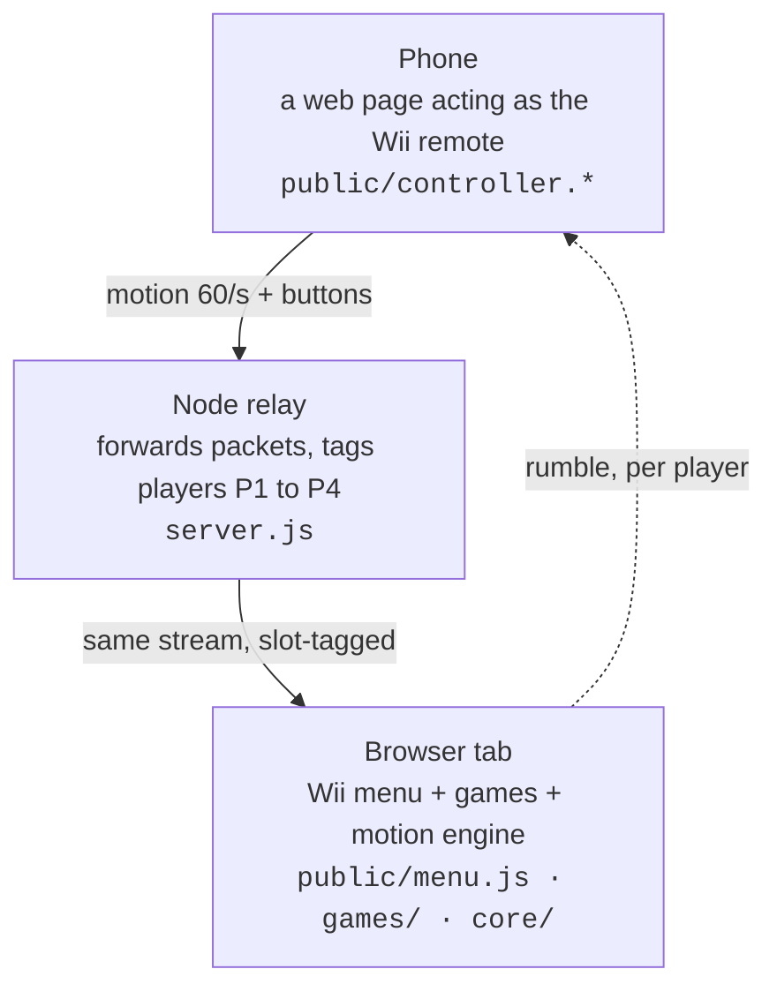

# SenWii


Motion-controlled games for the browser — your phone is the remote. A
Node/Socket.io relay streams phone IMU data over the LAN to a game running on
the PC.

## Layout

```
server.js         Socket.io relay + static serving. Auto-discovers games/.
public/           Launcher (index.html) + the shared phone controller.
games/<slug>/     One folder per game, each with its own index.html.
```

A game is any folder under `games/` containing an `index.html`. No registry to
edit — the server scans on boot. `game.json` (title/tagline/emoji) is optional
and only feeds the launcher card.

## Things that will bite you

- **Sensors need HTTPS.** Browsers block motion sensors on insecure origins and
  Chrome does it silently — listeners attach, no error, no events. `npm start`
  serves HTTPS with a self-signed cert. `HTTP=1` is mouse-only.
- **Never send orientation `volatile`.** Socket.IO drops volatile packets when
  the transport isn't writable, which on long-polling is most of the time.
- **Don't reduce the mapping back to raw Euler angles.** Aim is measured in a
  calibrated frame built from the player's actual grip; the naive version breaks
  entirely for anyone holding the phone upright.
- **A page navigation is a new socket.** Menu → game and game → menu both tear
  down the old connection and open a new one, so the new page must reclaim the
  old room code (stashed in `sessionStorage`, see `core/splash.js`) or every
  phone that already joined gets silently stranded. The server holds a closed
  room open for 8 seconds specifically for this handoff.

## Quick start

Requires **Node.js 22+**, **OpenSSL**, a computer browser with WebGL 2, and a
motion-capable phone browser on the **same Wi-Fi**.

```bash
git clone https://github.com/utachicodes/SenWii.git
cd SenWii
npm ci
npm start
```

1. Open **https://localhost:8443/** on your computer. On macOS, Chrome opens
   automatically.
2. Scan the launcher's QR code with your phone. Accept the local self-signed
   certificate, tap **Enable motion sensors**, and allow access.
3. Choose a game and follow its controls. Stop the server with **Ctrl+C**.

**Phone motion requires HTTPS.** Use the QR code or the terminal's **Phone remote**
address, not `localhost` on your phone. SenWii is designed for shared local-network
play.

## Games

| Game | How to play | Players |
| --- | --- | --- |
| [Mario Kart](games/mario-kart/README.md) | Hold your phone sideways to steer, drift, boost and use items. The linked guide covers controls and included assets. | 1 human + 7 CPU racers |
| [Fruit Ninja](games/fruit-ninja/) | Swing to slice fruit, dodge bombs and build combos. | Up to 4 |
| [Alien Attack](games/alien-attack/) | Tilt to fly and press A to fire. | 1 |
| [Shooting Range](games/shooting-range/) | Point and press A to hit targets against the clock. | 1 |

Golf, Table Tennis, Swordplay, Kart Time Trial and Island Flyover exist under
`games/` but are marked `hidden` in their `game.json` — in active development,
reachable by direct URL, not yet on the launcher menu.

## How it works



A real Wii needs an IR sensor bar to know where the remote points; SenWii replaces it with pure software. The
engine learns each phone's gyro axis conventions from its own data at runtime
(they genuinely differ between devices), heals drift back toward the true pose
between swings, and dead-reckons the cursor slightly ahead of the packet
stream so it never feels laggy.

The relay is room-based: every PC that connects gets its own short join code
and its own up-to-4 phone slots, so two PCs on the same network (or, run
online, two unrelated groups on the same server) never see each other's
packets. The menu's QR and join panel encode that code; the controller page
reads it from `?room=`.

## Troubleshooting

- **Cannot connect:** check both devices are on the same Wi-Fi, allow Node.js
  through the firewall, and avoid guest networks that isolate devices.
- **Buttons work but motion does not:** check HTTPS and motion permissions. If
  the terminal reports an HTTP fallback, install OpenSSL and restart.
- **Black screen:** enable WebGL 2 / hardware acceleration in the computer browser.
- **No sound:** click the game to unlock audio and check its mute control.

Set `PORT` to use another port, or `NO_OPEN=1` to skip auto-opening Chrome.

## License

[MIT](LICENSE). Built by [Abdoullah Ndao](https://github.com/utachicodes) on
top of the original OpenWii concept by Patrick Sun. This is an independent fan
project, not affiliated with or endorsed by Nintendo.