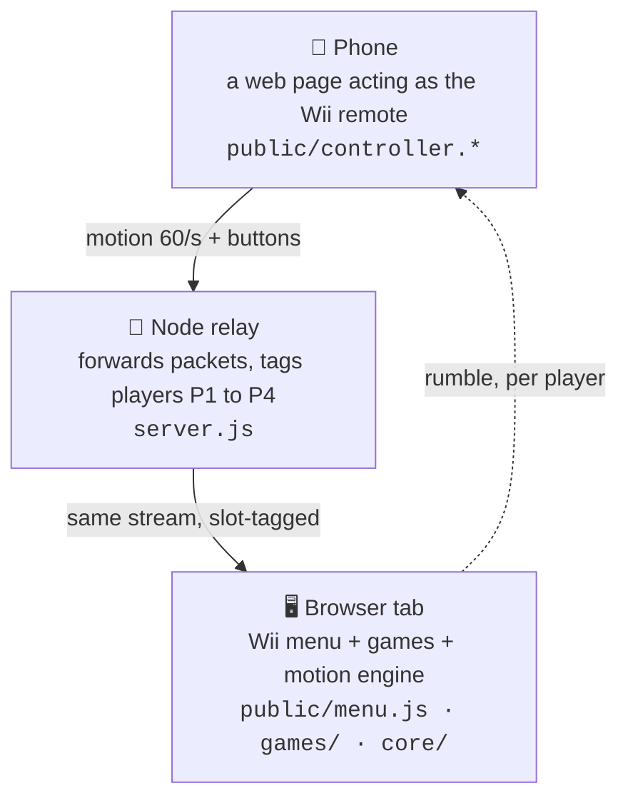

# 🕹 SenWii

Motion-controlled games for the browser — your phone is the remote. A
Node/Socket.io relay streams phone IMU data over the LAN to a game running on
the PC. See **README.md** for the architecture and the hard-won gotchas.

## Layout

```
server.js         Socket.io relay + static serving. Auto-discovers games/.
public/           Launcher (index.html) + the shared phone controller.
games/<slug>/     One folder per game, each with its own index.html.
```

A game is any folder under `games/` containing an `index.html`. No registry to
edit — the server scans on boot. `game.json` (title/tagline/emoji) is optional
and only feeds the launcher card.

Source: https://www.instagram.com/reel/DZiAyThpC63/

## Things that will bite you

- **Sensors need HTTPS.** Browsers block motion sensors on insecure origins and
  Chrome does it silently — listeners attach, no error, no events. `npm start`
  serves HTTPS with a self-signed cert. `HTTP=1` is mouse-only.
- **Never send orientation `volatile`.** Socket.IO drops volatile packets when
  the transport isn't writable, which on long-polling is most of the time.
- **Don't reduce the mapping back to raw Euler angles.** Aim is measured in a
  calibrated frame built from the player's actual grip; the naive version breaks
  entirely for anyone holding the phone upright.

## Working agreement

Commit directly to `main` — no feature branches, no PRs. Commit only when asked.

Today's date: Sun Nov 15 2026

Here is some useful information about the environment you are running in:
<env>
  Working directory: /Users/adbovllah/Documents/OPENSOURCE/OpenWii
  Workspace root folder: /Users/adbovllah/Documents/OPENSOURCE/OpenWii
  Is directory a git repo: yes
  Platform: darwin
  Prefer /private/var/folders/40/2nplkz992fd8tqf7d96w6fk00000gn/T/opencode over generic system temporary directories such as /tmp; it is pre-created and approved for external access.
</env>

## Quick start

Requires **Node.js 22+**, **OpenSSL**, a computer browser with WebGL 2, and a
motion-capable phone browser on the **same Wi-Fi**.

```bash
git clone https://github.com/utachicodes/SenWii.git
cd SenWii
npm ci
npm start
```

1. Open **https://localhost:8443/** on your computer. On macOS, Chrome opens
   automatically.
2. Scan the launcher's QR code with your phone. Accept the local self-signed
   certificate, tap **Enable motion sensors**, and allow access.
3. Choose a game and follow its controls. Stop the server with **Ctrl+C**.

**Phone motion requires HTTPS.** Use the QR code or the terminal's **Phone remote**
address, not `localhost` on your phone. SenWii is designed for shared local-network
play.

## Games

| Game | How to play | Players |
| --- | --- | --- |
| 🏎️ **[Mario Kart](games/mario-kart/README.md)** | Hold your phone sideways to steer, drift, boost and use items. The linked guide covers controls and included assets. | 1 human + 7 CPU racers |
| 🍉 **[Fruit Ninja](games/fruit-ninja/)** | Swing to slice fruit, dodge bombs and build combos. | Up to 4 |
| 👾 **[Alien Attack](games/alien-attack/)** | Tilt to fly and press A to fire. | 1 |
| 🎯 **[Shooting Range](games/shooting-range/)** | Point and press A to hit targets against the clock. | 1 |
| 🎨 **[Sketch](games/drawing/)** | Point and press A to draw. Choose colors, brushes and an eraser. | 1 |

## How it works



A real Wii needs an IR sensor bar to know where the remote points; SenWii replaces it with pure software. The
engine learns each phone's gyro axis conventions from its own data at runtime
(they genuinely differ between devices), heals drift back toward the true pose
between swings, and dead-reckons the cursor slightly ahead of the packet
stream so it never feels laggy.

## Troubleshooting

- **Cannot connect:** check both devices are on the same Wi-Fi, allow Node.js
  through the firewall, and avoid guest networks that isolate devices.
- **Buttons work but motion does not:** check HTTPS and motion permissions. If
  the terminal reports an HTTP fallback, install OpenSSL and restart.
- **Black screen:** enable WebGL 2 / hardware acceleration in the computer browser.
- **No sound:** click the game to unlock audio and check its mute control.

Set `PORT` to use another port, or `NO_OPEN=1` to skip auto-opening Chrome.

## License

[MIT](LICENSE) for the software. This independent fan project is not
affiliated with or endorsed by Nintendo.

---

## Credits

**Project:** SenWii  
**Creator:** Abdoullah Ndao (coding name: utachi)  
**GitHub:** https://github.com/utachicodes/SenWii  
**Original concept:** OpenWii by Patrick Sun  
**License:** MIT — free for non-commercial use, modification, and distribution

**Acknowledgments:**
- Patrick Sun for the original OpenWii concept and codebase
- All contributors and testers who helped refine the motion engine
- Nintendo for the Wii inspiration (this is a fan project, not endorsed by Nintendo)
